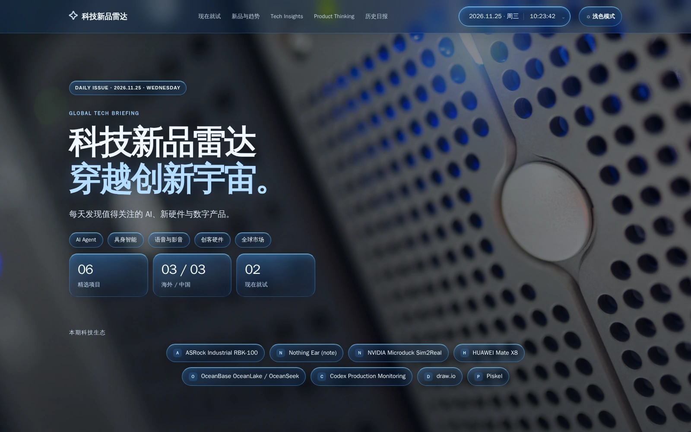

# 科技新品雷达 · Tech Radar

[](https://tech-radar-daily.vercel.app/)


每天发现值得关注的 AI、新硬件与数字产品。

**[打开正式网站 →](https://tech-radar-daily.vercel.app/)**

面向产品经理、开发者、创客与科技爱好者的中文科技日报。聚焦真实科技新品、产品体验与设计思考，提供官方产品链接及历史刊期。

## 网站效果图

**首页 · 冷电蓝玻璃与科技光影**

[](https://tech-radar-daily.vercel.app/)

**新品与趋势 · 产品卡片与真实产品配图**

[](https://tech-radar-daily.vercel.app/#radar)

当前背景：[panumas nikhomkhai · 数据中心摄影（Pexels）](https://www.pexels.com/photo/computer-server-in-data-center-room-17489156/)，2026-11-25 正式站已采用。

## 界面与功能

| 栏目 | 内容 |
| --- | --- |
| 现在就试 | 实用工具、体验入口与上手说明 |
| 新品与趋势 | 全球新品、重要版本更新、分类筛选、官方来源 |
| Tech Insights | 科技趋势与产品洞察 |
| Product Thinking | 每日产品方法与案例 |
| 历史日报 | 日期归档与中文日历 |

视觉设计采用冷电蓝透明玻璃、顶部渐隐高光、半透明胶囊和每日高清科技风摄影与授权设计素材；产品主图完整展示，搭配同源模糊背景。支持深浅色主题与响应式布局。

## 项目结构

```text
Tech-radar/
├── README.md
├── site/                    # 2026-11-25 生产页面快照
│   ├── index.html           # 当日首页
│   ├── archive/             # 11 月 17–24 日历史日报
│   ├── calendar-lunar.js    # 日历依赖
│   └── *.css / *.js         # 样式和交互依赖
├── source/                  # Vercel 原始构建源码备份
│   ├── EXPORT-MANIFEST.json # 文件来源、大小、SHA 和排除项
│   ├── clear-glass-build.js # 首次备份构建入口
│   ├── package.json
│   ├── vercel.json
│   └── *.js / *.css / src/
└── vercel.json              # 静态快照部署配置
```

## 本地浏览

```bash
git clone https://github.com/Koko08071/Tech-radar.git
cd Tech-radar
python -m http.server 8000 --directory site
```

打开 http://localhost:8000 。静态快照包含实际发布的页面与脚本，不需要重新运行历史构建链。第三方图片保留网络来源，部分历史图片可能因原链接失效而无法展示；需要互联网连接，并不保证完全离线运行。

## Vercel 部署

可以将仓库导入 Vercel，使用根目录的静态部署配置（输出目录 `site`）。现有正式站仍由原生产项目发布，本仓库目前记录其源码与页面快照；尚未将生产项目切换为 Git 自动部署。

## 每日更新流程

计划每天北京时间 06:00 运行：

1. 核查全球科技新品及版本更新，跨期去重并保留来源。
2. 核验产品配图、生成新刊与归档，保持 UI 模板。
3. 测试页面并发布至 Vercel，确认正式域名实际更新。
4. 同步 GitHub 源码、构建配置、当日页面、归档与 README；检查所有链接和效果图，背景或 UI 变化时更新真实高清截图。
5. 复核正式站与 GitHub main 的版本一致性，记录实际提交。

实际发布以网站和 GitHub 提交记录为准。定时任务由 ChatGPT 自动任务执行，并非本仓库自身的 GitHub Actions 定时爬虫。

## 源码恢复范围

首次同步依据生产部署 dpl_C9mtZUSQd4vdo5r6G2X38aV6yS9L 的 79 个源文件，已恢复 76 个完整文件与原构建配置。两个历史文件暂未公开：`issue23-images.js` 触发凭据检查；`fogg-zh-annotated.webp` 需核实素材再分发许可。因此 `source/` 是审查过的原始源码备份，旧构建链尚不能保证完整重建；请使用 `site/` 直接浏览。

## 图片与版权

产品图片、摄影作品、品牌标识及理论插图的权利归各自权利人；保留原始来源链接，未经许可不要将第三方图像作为独立素材再分发。日历依赖 lunar-javascript 采用其上游许可。视觉参考：[Langflow](https://www.langflow.org/) 与 Apple 玻璃材质设计。
