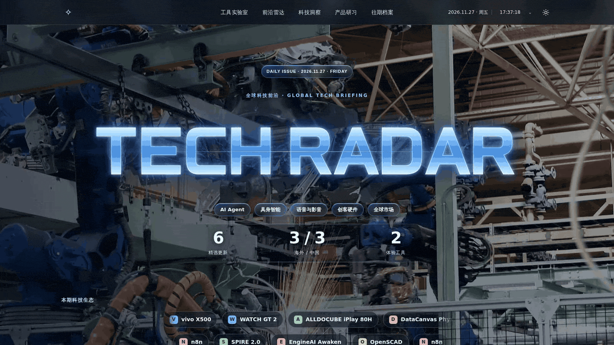

# 科技新品雷达 · Tech Radar

[](https://tech-radar-daily.vercel.app/)


**[打开正式网站 →](https://tech-radar-daily.vercel.app/)**

面向产品经理、开发者、创客与科技爱好者的中文科技日报。聚焦全球真实科技新品、重要版本更新、产品体验与设计思考，提供来源链接、真实产品配图及历史刊期。

## 首页动态预览

[](https://tech-radar-daily.vercel.app/)

*正式站录屏，包含动态背景、TECH RADAR 主标题、极简数字信息条与带彩色识别图标的横向滚动科技生态标签。点击动图可进入正式网站。*

## 最新刊期 · 2026.11.28

本期精选 6 项产品与技术更新，按发布市场区分海外与中国相关动态：

- **KT 三丽鸥儿童手机**：基于 Galaxy A18 LTE，11 月 27 日韩国开售。
- **XREAL AURA**：Android XR 空间计算眼镜在日本上市。
- **ASRock Arc Pro B65 Creator 32GB**：专业工作站显卡在日本渠道发售。
- **OlloBot OlloNi SS1**：家庭陪伴机器人预订计划公告，尚未上市。
- **智元精灵 G2**：龙旗产线精密装配部署新进展。
- **LingBot-Map 2.0 / Navi**：蚂蚁灵波发布开源三维重建与空间记忆导航模型。

工具实验室：Excalidraw、Squoosh。产品研习：费茨定律（Fitts's Law），以初代 iPhone 多点触控为经典案例。背景摄影：[ThisIsEngineering · Pexels](https://www.pexels.com/photo/engineers-holding-circuit-board-3912373/)；动态背景：Engin Altundağ · Pexels。实际图片来源见 [线上素材清单](https://tech-radar-daily.vercel.app/assets/2026-11-28-image-sources.json)。

正式域名保持不变；手机端采用双行导航、单列内容、按需加载图片及低流量背景策略。发布检查涵盖 320 / 375 / 390 / 430 / 768 px 浏览器视口，正式站与仓库首页刊期一致后才录制 README 动图。

## 产品研习内容原则

- 本栏目定位为产品经理经典理论与方法论学习，不做当日科技新闻的延伸评论。
- 每期先讲理论定义、提出背景、核心结构和适用场景，再用与理论高度匹配的经典产品或经典功能解释，例如 Amazon 1-Click、iPhone 多点触控、Google 搜索、微信红包等。
- 案例事实优先引用产品官方资料；公开资料未披露的后台流程必须标注为教学推演，不得写成企业真实内部实现。
- 理论图紧跟理论说明，优先使用权威原图；无法直接使用时自行绘制并标注理论来源。案例照片不能代替理论图。

## 视觉与功能

- 全屏真实科技主题动态背景、金属质感 TECH RADAR 标题、极简数字信息条与横向滚动科技生态标签。
- 深色与浅色两套独立主题，太阳/月亮图标切换，支持响应式布局。
- 导航左侧仅保留返回首页的品牌图标，五个栏目居中，日期和主题采用轻量图标控件，当前栏目随滚动高亮；首页统计数字不补前导零。
- 工具实验室、前沿雷达、科技洞察、产品研习、往期档案五大栏目。
- 历史日报按日期归档，日历可跳转历史刊期。
- 首页不展示额外副标题，突出刊期和主标题。

## 项目结构

```text
Tech-radar/
├── README.md
├── docs/
│   └── homepage-preview.gif      # 正式站首页高清动态预览
├── scripts/
│   └── capture-homepage-preview.cjs
├── .github/workflows/
│   └── capture-homepage-preview.yml
├── site/
│   ├── index.html             # 2026-11-28 首页快照
│   ├── archive/               # 11 月 17–27 日历史日报
│   ├── calendar-lunar.js
│   └── *.css / *.js
├── source/
│   ├── nov28-final.html       # 当期生产页面源码
│   ├── nov28-final-build.js   # 当期构建入口
│   ├── nov28-final-release.js # 图片校验、归档与发布检查
│   ├── EXPORT-MANIFEST.json   # 最新 production deployment 文件清单
│   ├── vercel.json
│   └── 历史刊期及构建脚本
└── vercel.json
```

## 本地浏览

```bash
git clone https://github.com/Koko08071/Tech-radar.git
cd Tech-radar
python -m http.server 8000 --directory site
```

打开 http://localhost:8000 。静态快照包含页面、脚本与历史归档；第三方图片保留网络来源，需要互联网连接，不保证完全离线运行。

## 每日发布与核验

- **06:00（北京时间）**：每日新品研究、页面制作、归档、构建与 Vercel Production 发布。
- **07:00 / 09:00（北京时间）**：独立核验当天刊期、图片、归档与正式域名；若主任务漏发或内容不完整，自动补发。
- 只有 Production 部署为 READY、正式域名 HTTP 200、当天内容和关键图片可访问，才算发布成功。
- **每次更新（含日更、UI 微调、功能修复）均同步 GitHub `main`**：首页快照、实际生产源码、构建脚本、配置、部署清单和 README；不得只更新 Vercel。
- 首页视觉或交互改版后，GitHub Actions 自动录制正式站 7 秒循环动图（优先 1440 × 810、12 fps，按 25 MB 上限自适应编码），更新 `docs/homepage-preview.gif` 并同步 README；不再用静态截图代替动态背景。
- 自动任务由 ChatGPT 自动化执行，不是本仓库内的 GitHub Actions 定时爬虫；不发送邮件。

## Vercel 部署

正式网站：[tech-radar-daily.vercel.app](https://tech-radar-daily.vercel.app/)。生产项目使用独立的 Vercel 构建入口；本仓库保留静态快照、每日源码和构建脚本。不要直接将根目录静态配置切换为生产项目的唯一构建来源，以免覆盖历史发布流程。

## 源码恢复说明

当前生产部署已同步至 `source/EXPORT-MANIFEST.json`。历史恢复过程中有两个旧文件未纳入公开源码：`issue23-images.js` 需要进一步检查，`fogg-zh-annotated.webp` 需要核实素材再分发许可。当前 11 月 28 日刊期已通过构建脚本完成 Production 发布；后续继续保留原始来源与许可记录。

## 图片与版权

产品图片、摄影作品、品牌标识及理论插图的权利归各自权利人；保留原始来源链接，未经许可不要将第三方图像作为独立素材再分发。日历依赖 lunar-javascript，按其上游许可使用。视觉参考：[Langflow](https://www.langflow.org/) 与 Apple 玻璃材质设计。
